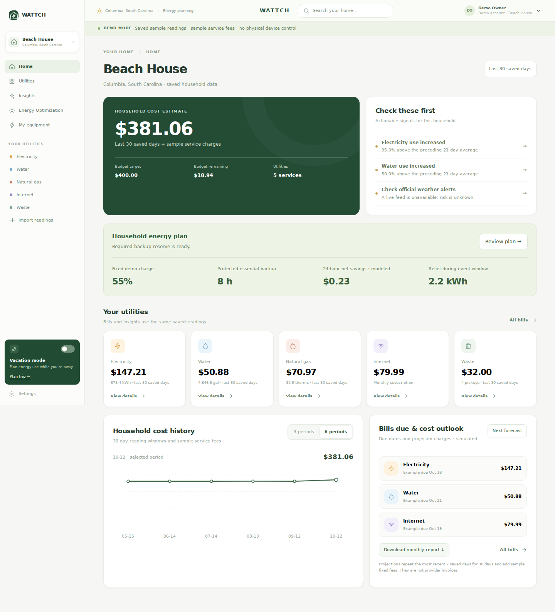
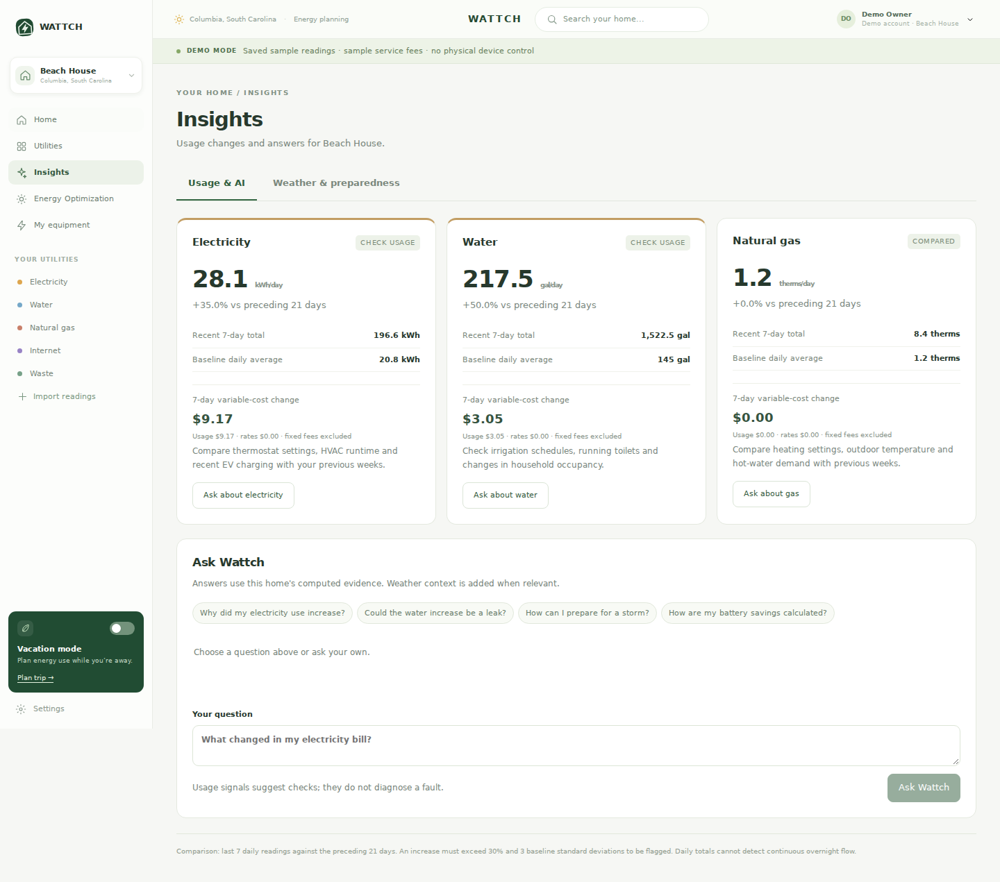
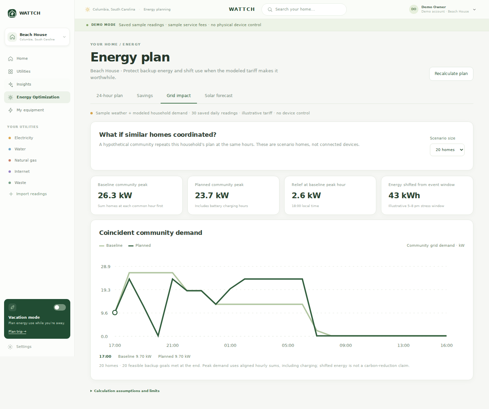

# Wattch

**Winner — [MLH] Best Use of Tiger Data, PalmettoHacks 2026**

A household utility and energy-planning MVP built by a four-person team during the October 10–11, 2026 hackathon. Wattch combines stored utility history, household-specific AI explanations, weather preparedness and simulated battery/grid planning.

[Devpost submission](https://devpost.com/software/wattch-3tw1fh) · [Demo video](https://www.youtube.com/watch?v=fTl4sWiMcjc) · [Hardware simulation](https://wokwi.com/projects/477573151899236353)

[Automated verification workflow](.github/workflows/ci.yml)

## What it does

- Manage electricity, water, gas, internet and waste for multiple homes.
- Compare saved usage, explain cost changes and import daily utility readings through CSV.
- Ask a Gemini assistant about the selected home's computed evidence, with clearly labeled local answers when the API is unavailable.
- Review Open-Meteo forecasts, National Weather Service alerts and regional Columbia Water updates.
- Model a 24-hour battery plan with efficiency, wear and essential-load reserve constraints; inspect a hypothetical community's grid impact.
- Demonstrate an ESP32 smart-breaker concept in Wokwi, including vacation controls and a latched overload/reset scenario.

Readings and scenarios are explicitly labeled as simulated or user-supplied. Utility-provider account connections, certified electrical equipment control and public user authentication are future work.

## Screenshots

### Household overview


### Usage insights


### Modeled grid impact


Screenshots use the app's labeled sample household data.

## Team

| Teammate | Contribution areas |
| --- | --- |
| [Aditya Anandkumar](https://github.com/AdityaA26) | Battery autopilot and grid-event logic, shared scenarios, ESP32 smart-breaker prototype and hardware design |
| [Nihal Katta](https://github.com/NihalK321) | Forecast/resilience backend, React household and utility dashboards, vacation/account/equipment features and final demo snapshot integration |
| [Neeshan Syed](https://github.com/SYED-NEESHAN) | Frontend/backend feature planning and requirements, initial Streamlit utility dashboard and early insights presentation, and Devpost hackathon submission preparation |
| [Kartikeya Pendem](https://github.com/kartikeya1107) | Household-analysis backend, TigerData/Gemini integration, savings/grid calculations, shared data integration and final frontend/backend polish |

The team collaborated on integration, debugging, testing and presentation. See [CONTRIBUTORS.md](CONTRIBUTORS.md) for evidence and the preserved development histories.

## Run locally

Requires Python 3.10+ and Node 18+. Verification runs on Python 3.12 and Node 24.

```bash
git clone https://github.com/AdityaA26/Wattch.git
cd Wattch
python3 -m venv .venv
source .venv/bin/activate
npm ci --prefix frontend
npm run build --prefix frontend
python -m person4.server
```

Open **http://127.0.0.1:8000**. The Python server serves both the built React app and the API. Keep its terminal running. If you configured a different `PORT`, use the printed port.

Without credentials, the app uses local SQLite storage and labeled local explanations. To enable your own Gemini/TigerData configuration:

```bash
cp person4/.env.example person4/.env
python -m person4.configure_key
python -m pip install -r person4/requirements-tiger.txt
python -m person4.configure_database
```

The setup prompts hide the API key and database URI. Choose a Gemini model available to your project through `GEMINI_MODEL` in the local `.env`; leaving it blank enables discovery. Restart `python -m person4.server` after configuration. Keep real credentials in the ignored `person4/.env`.

For frontend development, run `npm run dev --prefix frontend` alongside the backend. Rebuild the frontend before using the single-server demo.

## Technology and data sources

| Component | Role in Wattch |
| --- | --- |
| React, JavaScript, CSS and Vite | Household interface and production frontend build |
| Python HTTP API | Shared household analysis, billing estimates and energy planning |
| TigerData / PostgreSQL / TimescaleDB | Persistent household profiles and dated utility readings using hypertables and daily `time_bucket` queries |
| Gemini API | Plain-language explanations grounded in computed household evidence; specialized through instructions/context, without custom model training |
| Open-Meteo | Forecast inputs used for weather preparation and solar estimates |
| National Weather Service | Official US weather alerts |
| Columbia Water RSS | Regional published water alerts and updates |
| ESP32 / Arduino / Wokwi | Standalone smart-breaker simulation with OLEDs, controls and virtual relays |

The weather forecasts are used alongside utility history; they are not currently stored in TigerData. The web dashboard and ESP32 simulation are separate prototypes. QNX/MQTT telemetry is a proposed deployment design, not a running connection.

## Hardware and project scope

[Hardware source and design](hardware/smart-breaker/README.md) cover current controls, a proposed QNX gateway, data flow, budget assumptions, power/enclosure considerations and failure behavior.

Battery and grid results are modeled scenarios. The planner includes charging demand, preserves backup reserve and compares plans with equal ending battery energy. It does not dispatch a battery or enroll real homes in a utility program.

See [technical notes](docs/TECHNICAL_NOTES.md) for calculation assumptions, missing-data behavior, CSV format, provenance and limitations. The [hackathon handoff](README_FINAL_DEMO.md) records the original demo workflow.

## Verification

GitHub Actions runs the existing Python and JavaScript checks plus the frontend build. Provider tests use isolated storage and mocked responses rather than spending Gemini quota.

```bash
python -m unittest person4.tests person4.tests_upgrade person4.tests_gemini person4.tests_dashboard person4.tests_demo_api
python -m unittest discover -s tests
node --test tests/test_wattch_ui_analytics.mjs tests/test_insights_bridge.mjs tests/test_dashboard_data.mjs
npm run build --prefix frontend
```

The test suite contains 93 Python checks and 14 JavaScript checks. A Gemini provider badge in an actual response verifies a live call; a configured key or a local fallback does not.
