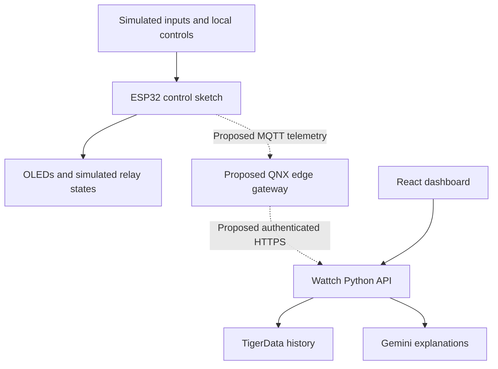

# Wattch smart-breaker prototype

[Run the Wokwi simulation](https://wokwi.com/projects/477573151899236353) · [Source sketch](sketch.ino) · [Simulator wiring](diagram.json)

This is a standalone ESP32/Arduino simulation for Wattch's hardware-design track. It models household demand, solar generation, battery energy, vacation controls and a latched overload trip. It does not run QNX, connect to the React dashboard or control a real electrical panel.

## Run the demo

1. Open the Wokwi project and keep the round **load dial low**.
2. Set the slide potentiometer to the desired **starting battery charge before pressing Play**. The sketch reads it once during setup.
3. Press Play. One OLED shows energy source, virtual time, solar estimate, battery charge and modeled load; the other shows circuit states.
4. Toggle Vacation Mode. AC/Eco, water-heater and outlet relays turn off; fridge, Wi-Fi/security and lights remain on while the controller is not tripped.
5. Raise the load dial. When modeled demand exceeds 15 A at the assumed 120 V, the trip latches, **all six relay outputs turn off**, the red LED lights and the buzzer sounds.
6. Lower the load, then press reset. Reset clears the trip only when the modeled demand is back at or below the threshold.

The loop includes a 200 ms delay, roughly five updates per second. Virtual time advances by half an hour per real second, beginning at 04:00.

## Current inputs and interfaces

| Item | Interface | What the code actually uses |
| --- | --- | --- |
| Round load potentiometer | ESP32 ADC, GPIO 34 | Extra virtual appliance load |
| Slide potentiometer | ESP32 ADC, GPIO 35 | Initial battery charge, read once at startup |
| Solar generation | Software virtual clock | A sine-shaped daytime model from 06:00 to 18:00; no solar input slider |
| Vacation switch and reset button | GPIO 33 and 32 | Local simulated controls |
| Two OLEDs | I²C, GPIO 21/22, addresses 0x3C and 0x3D | Energy and circuit-state displays |
| LEDs, buzzer and six virtual relays | GPIO | Status, alert and circuit-output simulation |

The virtual battery is 10 kWh. Discharge uses only energy above its 20% reserve. Illustrative grid rates are $0.08/kWh overnight and $0.22/kWh otherwise. Solar supplies modeled loads first, surplus solar can recharge storage, and grid supplies the remaining demand.

These are independent prototype parameters. The web planner has its own documented battery settings, tariffs, efficiencies and wear costs. There is no shared live state between the two demos.

## Proposed deployment and QNX role

The next deployment design would replace virtual inputs with metering and inverter telemetry. An ESP32 controller would publish measurements over MQTT to a QNX edge gateway. The gateway would coordinate local scheduling and communicate with the Wattch backend through an authenticated HTTPS adapter.

QNX is proposed for predictable local monitoring and coordination. This repository does not contain a QNX build, MQTT transport, measured timing guarantees or an implemented device-to-dashboard bridge.

Solid arrows show existing paths within their respective prototypes. Dotted arrows show future integration.

## Deployment parts and budget assumptions

These figures are planning budgets carried forward from the team's design, not current vendor quotes or confirmed volume discounts. The 100-unit column is a target **per-unit** budget at that quantity.

| Proposed component | One-unit budget (USD) | Per-unit budget at 100 units (USD) |
| --- | ---: | ---: |
| ESP32 controller board | 10 | 6 |
| Raspberry Pi 5 gateway, power, cooling and storage | 90 | 65 |
| Current transformer and conditioning | 18 | 10 |
| External ADC breakout | 10 | 6 |
| Isolated RS-485 interface for inverter/BMS telemetry | 15 | 8 |
| Opto-isolated low-voltage control interface | 20 | 10 |
| Enclosure, terminals and low-voltage supply | 70 | 35 |
| **Controller/gateway subtotal** | **233** | **140** |

Certified contactors, existing listed protection and professional installation were separately budgeted at $300–$800+ for a single installation and $200–$500+ per installation at scale. Quotes, electrical design, testing, certification, taxes and installation requirements must be established before deployment.

## Power and enclosure plan

- Supply the controller, displays and gateway with suitable isolated low-voltage power. Size supplies against the actual board and peripheral specifications.
- Separate sensing/control electronics from mains equipment. Use an appropriate enclosure, strain relief, labeled terminals and service access.
- Specify thermal management for the gateway and validate temperature, supply stability and restart behavior.
- A deployed system would use suitable sensor conditioning, isolation and certified equipment. The virtual relay modules are not a design for switching household mains.

## Failure behavior

| Scenario | Current simulator behavior | Deployment requirement |
| --- | --- | --- |
| Modeled overload | Latches a trip, turns all relays off, activates LED/buzzer | Existing certified protection remains primary; validate any supervisory load-control behavior |
| Load returns within the limit | Remains tripped until manual reset | Prevent automatic unsafe re-energization |
| Restart | Sets relay outputs off before the normal loop; battery is initialized from the slider | Validate startup sequencing and stale-state handling |
| Secondary OLED missing | Logs the problem; energy display continues | Preserve monitoring through an alternate indicator |
| Primary OLED missing | Setup stops | Define an independent fault indication and output state |
| Wi-Fi/cloud failure | No network dependency exists in this sketch | Keep local controls available; buffer/label telemetry and reject stale remote decisions |
| Sensor, BMS or actuator fault | Not implemented or tested in this prototype | Validate data, detect stale readings/feedback mismatches and define safe fallback states |

The 15 A comparison applies to the modeled household load. It is not a certified protection algorithm; virtual grid charging is not included in that threshold. The prototype's energy model is idealized and does not include battery efficiency or wear. The web planner handles those assumptions separately.

## Files and provenance

- `sketch.ino`: the original ESP32 control sketch.
- `diagram.json`: Wokwi wiring and simulated parts.
- `libraries.txt`: Adafruit display libraries.
- `wokwi-project.txt`: original simulator reference.
- `Wattch-Smart-Breaker-original.zip`: the original submitted source archive.
- `Smart_Breaker_Diagram.png`: the team's original concept diagram; the Mermaid flow above distinguishes implemented and proposed paths.

[Team credit and development history](../../CONTRIBUTORS.md) · [Main project](../../README.md)
